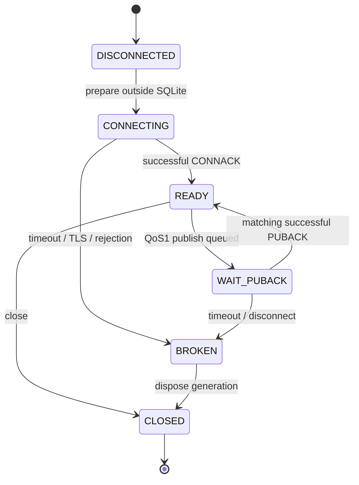
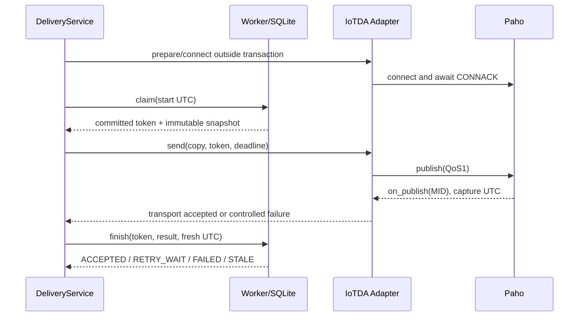

# C2.2-A detailed design - second review candidate

Baseline: d5548b70b2393897701b38ec14b2543cbf88a894. Date: 2026-11-06.
Status: proposed freeze, pending architecture approval. Documentation only; no cloud connection, business code changes, database migration or Git commit.
This readable UTF-8 edition replaces a corrupted draft. Protocol details not verified below are explicitly implementation gates.

## 1. Scope and frozen invariants

Keep Store._write atomicity, immutable Outbox payloads, stable IDs, ACK semantics, lease and attempt-token fencing. Keep Mock as default, all four modes and the existing 94-test baseline. No cloud business receipts, notifications, new SDK, dual writes or infrastructure. CLI adapter selection never grants message authorization.

## 2. Authorization decision (P0)

Origin DTO remains hardware/simulation/mixed/unknown. test_hardware is a deployment authorization class, NOT a new DTO source. Configuration maps an authenticated local hardware device to this class and a dedicated test cloud device. A payload cannot grant itself that class.

| Channel | DTO origin | Authorization | Action |
| --- | --- | --- | --- |
| Mock | simulation | existing policy | allow |
| Mock | hardware/mixed/unknown | any | existing rejection behavior |
| IoTDA test | hardware | explicit test_hardware device binding | allow on dedicated test cloud target |
| IoTDA test | simulation | explicit simulation-test binding and empty-channel initialization | allow only isolated test target |
| IoTDA test | mixed/unknown | any | reject |
| IoTDA production | hardware | explicit production binding | outside C2.2 release scope |

Each binding includes local_device_id, cloud_device_id, authorization_class, allowed_origins, environment=test, endpoint, mapping_version. No wildcard devices. One C2.2 worker/client uses one cloud identity; multiple target credentials are deferred. The operator must confirm test routes cannot notify real contacts. Metadata alone does not prove deployment isolation.

Worker checks its persisted channel policy, device mapping, origin and payload lineage before claim/send. Adapter independently checks the same immutable policy snapshot, message IDs, event/transition origin and device mapping before publish. Service validates adapter kind and policy fingerprint at composition time. Receipt provider is selected by policy, never accepted arbitrarily from adapter output.

Mock keeps its current FAILED/MOCK_SOURCE_NOT_ALLOWED semantics. IoTDA rejects unauthorized rows without publishing or rewriting their status; the bounded CLI step returns a controlled blocked diagnostic, not successful delivery. Emit bounded aggregate diagnostics rather than secrets or an unlimited busy loop. Historical simulation records never acquire authorization from a new CLI flag.

## 3. Policy persistence and compatibility (P0)

Keep delivery_policy(singleton=1, body TEXT) and all business tables unchanged. Existing Mock body stays byte-for-byte canonical-compatible:

```json
{"base":1,"cap":60,"lease":10,"maximum":5,"version":"mock-r05-v1"}
```

Proposed new canonical body (illustrative non-secret target names):

```json
{
  "version":"iotda-v1",
  "adapter_kind":"iotda",
  "receipt_provider":"iotda-mqtt-puback",
  "environment":"test",
  "endpoint":"test-instance.example.invalid",
  "port":8883,
  "mapping_version":"aquaguard-transition-v1",
  "bindings":[{"local_device_id":"test-local","cloud_device_id":"test-cloud","authorization_class":"test_hardware","allowed_origins":["hardware"]}],
  "base":1,"cap":60,"lease":30,"maximum":5,
  "connect_timeout_seconds":5,"connack_timeout_seconds":5,
  "puback_timeout_seconds":10,"finish_margin_seconds":5
}
```

Normalize bindings and origin lists before canonical comparison; duplicates are invalid. Persist no secret, derived password or CA private material. Compare semantic policy strictly at startup. Credentials may rotate without changing target identity; changing endpoint, device binding, mapping, timing or retry policy must not silently reinterpret queued records.

Opening rules:
- Existing mock-r05-v1: default Mock opens unchanged, including pending attempts and receipts. IoTDA refuses.
- Existing iotda-v1: matching IoTDA opens; Mock and mismatched policy refuse.
- No policy, no Outbox/attempts: explicit IoTDA initialization may persist its policy atomically BEFORE the first event; validate configuration before opening a writable store.
- No policy but any Outbox/attempts: IoTDA refuses, even if origins appear acceptable.
- Malformed/unknown policy: refuse; never repair silently.

No schema migration and no in-place Mock-to-IoTDA conversion in C2.2. Existing unfinished Mock Outbox remains in the original database and can only continue through Mock. Use a separately initialized test deployment/database for newly generated authorized test events; each deployment still has exactly one SQLite authority. Do not copy historical events or dual-write.

If an in-place conversion is later required, it is a separate reviewed migration: stop all writers/workers; create and verify a consistent SQLite backup (including WAL through SQLite backup API); inventory IDs/statuses/leases; produce a dry-run eligibility manifest; explicitly migrate in one transaction; verify IDs/payload hashes/counts. Rollback restores the backup only before any new writes or external sends; after that, restoration cannot undo external delivery and requires reconciliation. C2.2 supplies no conversion command.

Compatibility fixtures: use pinned baseline d5548b7 code to create actual database files for PENDING, SENDING, RETRY_WAIT, ACCEPTED, FAILED, independent Mock business receipt and custom policy. Close connections, copy each fixture, open with new code, verify sqlite_master, payload hashes, message/transition IDs, attempt tokens, receipts and policy. Exercise retry and expired leases on copies only. Also prove new Mock files reopen under baseline code; baseline must reject IoTDA policy. Never rewrite live user databases for tests.

## 4. Time and lease decision (P0)

claimed_at: UTC sample persisted by claim when acquiring the lease.
puback_received_at: UTC sample recorded by VERSION2 on_publish for the matching active generation/MID.
finished_at: fresh UTC sample immediately before finish; never reuse claimed_at for real IO.
Validate claimed_at <= puback_received_at <= finished_at and the existing lease boundary. Clock rollback is an error, not a reason to clamp timestamps.

Use time.monotonic for connection/publish deadlines, including remaining-budget calculations. UTC is for persistent facts only. Keep step(now=...) deterministic for old Mock callers; real CLI must inject a clock and sample again after send.

PUBACK followed by STALE: do not mark ACCEPTED, renew the lease or overwrite another attempt. Emit a controlled PUBACK_AFTER_LEASE diagnostic; current record stays unchanged. claim recovery releases expired attempts as today; retry may duplicate delivery using the same stable IDs. PUBACK timeout is UNKNOWN outcome, mapped to retryable failure without receipts. Never infer that the broker did not receive it.

Prepare connection outside SQLite before claim where possible. Send budget + finish margin must fit the lease (defaults: 10+5 < 30 seconds). Connection recovery inside an attempt must respect remaining lease budget; otherwise fail that attempt. No heartbeat in C2.2.

## 5. Paho 2.1.0 lifecycle (P0)

Use CallbackAPIVersion.VERSION2, MQTTv311, QoS=1, retain=False. Exact IoTDA authentication and wrapper requirements remain official-protocol verification gates before coding the wire mapping. No import of unreviewed probe modules.

Local source evidence: .venv-app/Lib/site-packages/paho/mqtt/client.py provides connect_timeout, socket.create_connection(timeout=...), MQTTMessageInfo.wait_for_publish, VERSION2 on_publish and loop_stop. Socket timeout does not establish a bound for DNS; loop_stop thread join is not a generally bounded cancellation primitive. Do not claim these issues are solved by Event.wait.

States:



Connect initiation and successful CONNACK are separate. Use connect_async and an owned network loop with no automatic retry ownership beyond the adapter attempt. One send in flight per adapter. Every new client gets a new generation UUID. Associate (generation, MID) with attempt token and stable message_id; do not use MID across generations.

Resolve early callback race: on_publish records (MID, reason, UTC time) in a bounded generation-local cache under lock even before publish returns. After publish returns, register MID and reconcile the cached callback. Clear cache on generation disposal; never reuse MIDs in one generation after 65535 requests: retire the idle generation first. Unknown, duplicate or retired-generation callbacks never update SQLite or complete another attempt. MQTTMessageInfo can supplement completion checks but cannot replace the actual callback timestamp. Fake must reproduce callback-before-return.

On PUBACK timeout/disconnect, dispose that client generation before any retry; do not leave an old client auto-republishing while SQLite schedules a new attempt. Failure to dispose stops the worker. on_publish only signals the send waiter; finish alone writes receipt facts. Transport receipt uses provider iotda-mqtt-puback and local receipt_id composed from message_id/generation/MID; it is not a cloud business receipt.

TLS requires CERT_REQUIRED and hostname checking, verified CA file and the configured endpoint. Never tls_insecure_set(True), never dump client credentials into logging.

Shutdown gate: prefer in-process Paho with explicit disconnect and loop stop only after proving the owned loop can exit under DNS/TCP/TLS failures. A daemon timeout is not cancellation. If bounded cleanup cannot be demonstrated, block Adapter release and separately review a managed subprocess boundary; do not silently introduce it or claim a hard timeout. Until this gate is resolved, C2.2-C is conditional. Fake tests verify requested cleanup and generation rules; they cannot prove OS network-thread cancellation.

Sequence:



## 6. Cloud mapping (P1)

Proposed complete envelope; protocol-wrapper approval remains a gate:

```json
{
  "object_device_id":"test-cloud",
  "name":"AquaGuard Event Transition",
  "id":"stable-message-id",
  "content":{
    "schema_version":"1.1",
    "mapping_version":"aquaguard-transition-v1",
    "message_type":"EVENT_TRANSITION",
    "message_id":"stable-message-id",
    "event_id":"stable-event-id",
    "transition_id":"stable-transition-id",
    "event_version":1,
    "origin":"hardware",
    "event":"FULL IMMUTABLE EVENT OBJECT",
    "transition":"FULL IMMUTABLE TRANSITION OBJECT"
  }
}
```

The last two values are objects in actual payloads, not the illustrative strings above. Validate duplicate envelope IDs against snapshot values. Topic is derived only from configured cloud device identity, proposed $oc/devices/{device_id}/sys/messages/up. No MID, token, secret or changing send timestamp in business payload. Serialize deterministically (UTF-8, fixed separators/key ordering, finite JSON values). Fixed mapping version and target binding produce identical bytes across retries. Do not reconstruct from the latest event row. Persisted policy prevents remapping outstanding records. Message-size limit requires official verification before release; tests use an injected bound, not an invented platform limit.

## 7. Configuration specification (P1)

Proposed explicit worker flag: --adapter mock|iotda, default mock. --mode remains Mock-only. A test-only IoTDA execution must additionally require explicit live-test enablement; this is operational intent, never authorization by itself.

| Environment variable | Validation / handling |
| --- | --- |
| AQUAGUARD_IOTDA_ENDPOINT | required DNS hostname, no scheme/path/userinfo/wildcards |
| AQUAGUARD_IOTDA_PORT | integer 1..65535, default 8883, TLS always |
| AQUAGUARD_IOTDA_CA_FILE | existing readable regular PEM CA file, parse before DB/network mutation |
| AQUAGUARD_IOTDA_DEVICE_ID | nonempty identity, reject topic separators/wildcards; matches binding |
| AQUAGUARD_IOTDA_DEVICE_SECRET | required secret; repr=False, never persist/log |
| AQUAGUARD_IOTDA_BINDINGS_FILE | explicit local JSON bindings, validate unique IDs and test environment |
| AQUAGUARD_IOTDA_LIVE_TEST | explicit enablement for manual connection only |
| AQUAGUARD_IOTDA_CONNECT_TIMEOUT | finite positive seconds, default 5 |
| AQUAGUARD_IOTDA_CONNACK_TIMEOUT | finite positive seconds, default 5 |
| AQUAGUARD_IOTDA_PUBACK_TIMEOUT | finite positive seconds, default 10 |

Lease/retry values remain worker configuration, must match persisted policy. Reject bool/NaN/infinity durations and invalid budget combinations. Endpoint/device binding values are non-secret but should be minimized in logs. Redact both raw and derived credentials in repr, validation errors, exceptions and callbacks. Do not enable Paho packet debug logging. Unit tests use sentinels and assert absence across stdout/stderr/log capture. No real credentials in fixtures or example files.

## 8. Test matrix and acceptance

All new offline MQTT tests use FakeMQTTClient, no cloud, DNS or actual credentials. Existing 94 regressions retain their SQLite and local-loopback tests; Fake requirement does not replace existing runtime checks.

| ID | Case | Required evidence |
| --- | --- | --- |
| T01 | original 94 regressions | 94 pass, zero failures/skips |
| T02 | Mock/IoTDA origin matrix | every row enforced at Worker and Adapter |
| T03 | pinned old DB copies | IDs/payloads/policies/receipts unchanged; retry recovery works |
| T04 | unauthorized identity and policy mismatch | zero publish calls, no fabricated success |
| T05 | TLS CA/hostname failure | controlled failure, no fallback to insecure TLS |
| T06 | absent/rejected CONNACK | monotonic deadline/error classification, no publish |
| T07 | publish rc failure | retry/failure with no receipt |
| T08 | PUBACK timeout | unknown outcome, no ACCEPTED/business receipt |
| T09 | early/duplicate/late PUBACK | exact generation/MID/token match, one completion |
| T10 | lease expiry and STALE | late PUBACK cannot overwrite state/new attempt |
| T11 | close success/failure/repeated close | thread lifecycle tracked, broken generation not reused |
| T12 | immutable mapping | bytes stable on retry and after later ACK |
| T13 | secret sentinel | absent from all diagnostic channels and stored rows |
| T14 | SQLite vs IO | independent connection obtains write transaction during connect/send/wait |
| T15 | real completion time/clock rollback | distinct UTC facts, lease checks preserved |
| T16 | device/mapping change and malformed policy | startup refuses without mutation |

Fake injection seam is client factory plus UTC/monotonic clocks and event scheduling. Include callbacks before publish return, callbacks after disposal and publish never completing. Real network cleanup and protocol behavior need a separate controlled validation step; do not mislabel Fake success as cloud verification. Existing tests are not rerun for a documentation-only change; prior verified baseline is 94 passed.

## 9. C2.2-B change list and later stages

B (pure configuration/mapping): add cloud_config.py, cloud_mapping.py, tests/test_cloud_config.py, tests/test_cloud_mapping.py. Use non-secret fixtures; do not install dependencies or modify business code. Verify official wrapper/auth/limits before claiming wire compatibility.
C (Adapter after lifecycle gate): add adapters/iotda.py, tests/test_iotda_adapter.py. Use fixed Paho 2.1.0.
D (explicit reviewed integration): add delivery_policy.py and policy tests; modify outbox.py, delivery.py, adapters/base.py as needed, run.py and related regression tests. Do not quietly include policy/runtime changes in B.
E: manual isolated test device validation after explicit operational authorization and configuration check. Separate PUBACK evidence, IoTDA tracking evidence and downstream business evidence.

No store.py, water.py, business ACK/API/frontend changes. Do not import or submit unreviewed Cloud-1 probe files. No Git commit in this review task.

## 10. Freeze and remaining gates

Proposed frozen decisions for review: existing business invariants; test_hardware as authorization class; per-database channel binding; unchanged legacy Mock policy; no in-place conversion; explicit two-layer authorization; transport-only ACCEPTED; distinct UTC facts; monotonic deadlines; immutable mapping; Fake matrix and staged file scope.

Still requiring confirmation/evidence: (1) approval of no in-place conversion and new test deployment requirement; (2) test-device authorization inventory and notification-route isolation; (3) official IoTDA wrapper/auth/size verification; (4) fixed Paho bounded connect/cleanup feasibility. Final policy defaults and config names above are proposed, not silently deployed.

Readiness: B can start after architecture approval, with wire-format compatibility assertions gated on official verification. C is NOT ready for unconditional release until lifecycle feasibility is demonstrated. D/E require their own compatibility and operational gates. No automatic implementation follows this document; stop for architecture review as requested in task_C2.txt.
