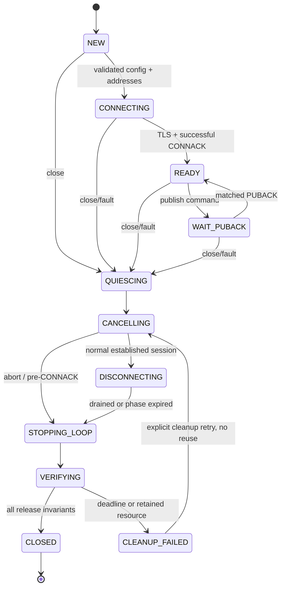

# C2.2-L2 lifecycle shutdown design - architecture review candidate

Baseline: a6c51afaeb2b9a81a7457381742ef649e0ab0707. Date: 2026-11-07.
Scope: documentation only. No implementation, Schema/Worker/CLI/Mock/ACK change, cloud connection, subprocess, Git commit or push. Primary audit: C22_LIFECYCLE_AUDIT.md.

## 1. Evaluation, goals and assumptions

The requested design is justified: timed Event/join behavior is insufficient and keepalive must not stand in for DNS/TCP/TLS deadlines. Prefer an in-process feasibility prototype; do not assume process isolation is mandatory.

Evidence labels: [S] Source Verified; [F] Fake Test Verified; [N] Local Network Verified; [U] Not Yet Verified. Proposed values/algorithms are always [U], not implemented capability. Local references below point to installed .venv-app/Lib/site-packages/paho/mqtt/client.py (2.1.0), Python312/Lib/socket.py, and repository adapters.

Current baseline cannot guarantee bounded exit [S,N]. Target [U]: close returns an honest CLOSED or CLEANUP_FAILED within a shared 5-second budget under a responsive scheduler/OS; CLOSED additionally requires all owned resources released. Returning CLEANUP_FAILED does not satisfy bounded reclamation. No hard real-time guarantee under a wedged OS, native resolver or arbitrary blocking callback.

Proposed in-process deployment assumptions [U]: endpoint identity is a DNS name; validated address inventory supplied before communication startup; no runtime system resolver on owned lifecycle thread; connector and TLS are nonblocking; callbacks are internal, finite and do not perform IO; queue sizes/packet sizes are bounded; no arbitrary injected backend in production. Address refresh is an explicit provisioned operation, never silently using stale addresses. If autonomous, cancellable DNS resolution is mandatory, evaluate an owned async DNS resolver separately.

## 2. Shared shutdown budget [U]

First close request atomically establishes D = monotonic()+5.0s. Concurrent/repeated requests attach to this close episode and NEVER extend D. Retry after CLEANUP_FAILED is an explicit new cleanup episode, not an implicit way to reset the original deadline. Generation remains unusable.

| Phase | Nominal cap | Work and escalation |
| --- | --- | --- |
| QUIESCING | .25s | reject new sends/claims through future integration; enqueue shutdown intent without waiting on publish lock; overflow is controlled failure |
| CANCELLING | .75s | wake selector; cancel connector/TLS work; resolve in-flight waiters as cancelled/unknown without changing IDs |
| DISCONNECTING | 1.0s | normal path attempts MQTT DISCONNECT drain while pump still running; abnormal/pre-CONNACK path skips graceful drain and closes owned transport |
| STOPPING_LOOP | 1.5s | unregister descriptors, close sockets/wakeup pair on owner thread, stop pump and wait for exit |
| VERIFYING | 1.5s | bounded join/ownership checks; publish CLOSED only when queue/waiter/thread/descriptor invariants hold |

Each phase uses min(D, phase_start+cap); unused capacity may be borrowed only while reserving the final verification allowance. No fresh five-second timeout inside a stage. Lock acquisition uses remaining overall budget or a nonblocking command/notification path. Reaching D returns CLEANUP_FAILED with owned resource inventory and delivery outcome. Do not mark disposed or spawn more generations to conceal retained resources.

Normal close preserves valid PUBACK facts already received, allows bounded graceful DISCONNECT, then closes transport without TLS close_notify waits. Abnormal close cancels IO and aborts transport; graceful MQTT/TLS shutdown is not required for local resource release. OS close and scheduler assumptions must be measured; cannot claim a universal kernel deadline [U]. Callback callers request shutdown only; they never synchronously join their own thread.

## 3. Unique ownership matrix [U]

| Resource | Sole owner | Others may do | Release condition |
| --- | --- | --- | --- |
| MQTT Client / protocol queues | communication reactor | enqueue commands | no active protocol callback, queues explicitly discarded/recorded after outcome capture |
| provisional TCP socket | connector within reactor | request cancel | selector unregister + socket close before ownership handoff |
| TLS socket | connector until handshake, then reactor transport owner | request cancel | exactly one close after unwrap ownership transfer; no double-close raw fd |
| established socket | reactor transport owner | inspect diagnostics only | close recorded and reference cleared; injected failure retains ownership |
| Paho pump | reactor | wake/request stop | run function returned, not just stop flag set |
| callback registry | reactor generation | register through commands | generation retired, callbacks detached, no late event accepted |
| publish waiter | transport attempt coordinator | signal result/cancel | completed once with typed delivery outcome, generation/MID/token preserved |
| DeliveryService | application composition layer | request quiesce | stops initiating work, persists only through Worker.finish |
| Outbox lease / attempt | SQLite Worker | communication returns evidence only | finish token/lease transaction or existing expiry recovery |
| reactor thread / join handle | supervisor owning wrapper | request shutdown | verified not alive after finalizer, no wrapper lock held while joining |
| wakeup socketpair/selector | reactor | send bounded wakeup | unregister and close all endpoints |
| address inventory | configuration provider | read immutable snapshot | refresh/revoke explicitly outside attempt; no DNS worker leakage |

Connector -> reactor handoff is an explicit single-owner transition. No business module closes raw network sockets. Supervisor may report failure but must not race the reactor closing the same descriptor.

## 4. Lifecycle states [U]



## 5. Shutdown sequence [U]

```mermaid
sequenceDiagram
    participant S as Service / supervisor
    participant A as Attempt coordinator
    participant R as Communication reactor
    participant P as Paho protocol
    participant W as SQLite Worker
    S->>A: quiesce, shared D
    A->>R: cancel/shutdown command + wakeup
    R->>R: stop accepting publish; cancel provisional IO
    R-->>A: stable outcome or unknown/cancelled
    opt normal established session and time remaining
        R->>P: enqueue DISCONNECT
        R->>P: pump writes until drained or phase cap
    end
    R->>R: unregister and close owned resources
    R-->>S: final resource inventory; return thread function
    S->>S: join with remaining budget; verify
    A->>W: finish only if valid token/lease and supported policy
    W-->>A: committed result or STALE
    S-->>S: CLOSED or CLEANUP_FAILED
```

Worker integration above is future design only. Current DeliveryService/Worker remains unchanged.

## 6. DNS/TCP/TLS options

| Option | Feasibility and tradeoffs | Evidence |
| --- | --- | --- |
| system DNS in network thread | socket.create_connection calls getaddrinfo before socket timeout; cannot safely kill resolver thread | S: Python socket.py:841,847,850,978; real resolver hang U |
| independent async DNS resolver | finite query budget/retries, own UDP/TCP sockets; must prevent fallback to blocking system resolver and implement caching/search/IPv6/TCP carefully; new dependency review | U |
| provisioned IP + original-host TLS | avoids runtime DNS; connector uses numeric IP while SNI/hostname verification uses original endpoint. Address inventory must be validated/refreshed and exhausted inventory fails closed. Never pin IP as certificate hostname | U; preferred first restricted prototype |
| custom socket lifecycle | nonblocking connect_ex + readiness/SO_ERROR; TLS do_handshake_on_connect=False and SSLWantRead/Write; owned selector cancellation and monotonic deadlines; integration with Paho connection internals needs explicit review | U |
| separate communication process | parent can escalate termination of owned process, OS normally releases handles; IPC, secret and Windows complexity; not automatic proof of kernel-level bounded termination | U; separate proposal only |

Proposed startup phase caps [U]: TCP total across all addresses 3s, TLS 3s, CONNACK 5s, PUBACK 10s. Each has one monotonic deadline; per-address attempts consume remaining total. Keepalive remains 60s as MQTT policy and is NEVER tuned to solve handshake timeout. Shutdown D overrides remaining operation budget immediately. Peer trust/hostname errors are permanent config/identity failures, not insecure fallback.

Source facts: Paho connect:1393-1435 invokes connect_async then reconnect. reconnect:1598 assigns _sock only AFTER _create_socket returns; _ssl_wrap_socket:4670-4671 sets timeout to keepalive. Public external-loop APIs loop_read:2082, loop_write:2107, loop_misc:2140 exist, but do NOT alone replace blocking DNS/TLS setup. _packet_queue:3758-3795 avoids inline loop_write when socket-register-write callback exists [S].

Critical feasibility gate [U]: external reactor + preconnected TLS transport requires a supported/maintainable Paho handoff. No public set-connected-socket API has been established. Explore a narrowly version-pinned connector override or upstream-supported adapter separately; review _create_socket/_sock_close/_reset_sockets ownership, callbacks and reconnect reset. Do not silently assign _sock or fork Paho in implementation. If that integration cannot be justified, restricted in-process proposal fails and isolation proposal is evaluated.

## 7. Paho operation plan

| Operation | Thread / deadline / failure |
| --- | --- |
| connect | proposed reactor connector; numeric address, nonblocking TCP/TLS, explicit phase deadlines; cancel closes provisional socket |
| CONNACK | reactor pumps protocol with socket-register-write callbacks; no blocking connect; expiry returns unknown/retry, abort session |
| publish | caller enqueues immutable bytes, reactor calls Paho; no application mutex held across backend IO; fixed bounded command queue |
| PUBACK | reactor records UTC receipt + monotonic tick; coordinator validates generation/MID/attempt/deadline, notifies once |
| disconnect | reactor invokes before pump stop; inspect rc, drain within phase cap; partial drain becomes forced close, not false success |
| loop_stop | not used in proposed external-loop design; installed Paho loop_stop:2351-2364 joins without timeout [S] |
| join | supervisor only, remaining D, no cleanup/publish locks held; timeout = CLEANUP_FAILED |
| socket cleanup | sole reactor owner closes established/provisional sockets and selector/wakeup resources; inspect resource inventory |

No blocking user callback/log sink on reactor. TLS certificate parsing and arbitrary filesystem access belong in preflight with their own documented bounds, not hidden inside close. Failure callbacks are typed by lifecycle phase; do not reuse on_connect for failures occurring after READY.

## 8. In-process vs process-isolated comparison [U]

| Aspect | Restricted in-process | Communication process proposal |
| --- | --- | --- |
| complexity | custom resolver/connector/reactor and Paho handoff | simpler isolation of blocking library, harder supervisor/IPC |
| exit determinism | conditional on all calls and callbacks cooperative | stronger parent containment; must verify kill/join and OS assumptions |
| recovery | recreate only after ownership released; retained thread blocks reuse | retire child, verify exit, start new generation |
| IPC | in-memory bounded commands | bounded framed IPC and ack/generation protocol |
| duplicate risk | unknown send outcome on cancel | same, including IPC/child crash windows |
| Outbox | only parent/application Worker writes SQLite | same; child has NO SQLite connection |
| Windows | selectors/socketpair supported but SSL behavior measured | spawn, __main__, child startup, pipe EOF, handles/Job Object require review |
| deployment | one process, possible dependency/version pin | process supervision, packaging and secret transport |

Isolation is not proven necessary yet. If runtime system resolver/native calls must remain and hard parent service responsiveness is required, thread-only cannot forcibly cancel them [S design boundary]. Separate draft: parent owns Outbox/leases and child process handle; child owns ALL Paho/network resources; pass immutable attempt/IDs via bounded IPC, secrets only over protected nonlogged channel; parent deadline sends stop then terminate/kill, joins and verifies exit. IPC silence means unknown delivery, never success. On Windows review descendant containment and credential exposure. Do not implement this draft without approval; never spawn replacement while old child ownership is unresolved.

## 9. Business state protection [U]

| Message position at close | Required action |
| --- | --- |
| not claimed | remain PENDING/RETRY_WAIT, no attempt created |
| claimed, no publish | finish controlled retry if lease valid; otherwise leave recovery to lease expiry |
| publish in progress | unknown outcome, no fabricated receipt; preserve original IDs/payload for retry |
| PUBACK received, finish pending | preserve receipt independently of cleanup error; fresh UTC finished_at and token/lease validation still required |
| STALE attempt | cannot overwrite newer attempt, cannot extend lease based on late PUBACK; report separately |

Communication shutdown never closes or ACKs a business event. Cleanup failure does not erase delivery fact, and PUBACK does not prove platform/business/contact success. No ID regeneration, payload reconstruction from latest Event or dual writes. SQLite timeout/commit scheduling is a separate service budget; network close SLO must not secretly include unbounded database work.

## 10. Exception handling matrix [U unless marked]

| Fault | Escalation and truthful result |
| --- | --- |
| DNS unavailable/hung | restricted profile has no runtime DNS; inventory missing/expired fails preflight; async resolver candidate must close owned queries |
| TCP refused/timeout | classified transient, next address only within remaining total; cancel connector socket |
| TLS stall | nonblocking handshake cancelled at phase/D; current baseline cannot do this [S,N] |
| CA/hostname invalid | permanent validation error, close provisional TLS socket, never disable verification |
| auth rejection/no CONNACK | permanent auth vs transient timeout, retire session |
| drop/no PUBACK | unknown/retryable; retain any earlier valid confirmation |
| disconnect partial/error | record graceful-close failure, abort socket, verify resource close |
| blocked callback/backend | cooperative design violated; CLEANUP_FAILED, no replacement; reconsider isolation |
| repeated/concurrent close | attach to same D/result, do not restart budget; explicit failed-cleanup retry only |
| socket close fails/thread alive | preserve exact owned inventory; no CLOSED/disposed; release blocked |

## 11. Reproducible local experiments and acceptance [U]

L3a feasibility ONLY after this review: prove Paho transport handoff using local endpoints with no cloud, credentials or business changes. If public hooks cannot support ownership, return a design decision rather than patch private internals silently.

L3b tests: deterministic resolver/connector/callback barriers; fake monotonic and selector wakeups; concurrent close shares D; queue overflow; partial write; socket transfer exactly once; failures during cleanup preserve outcome. Existing Fake cases already verify retained ownership and repeated close [F], not proposed SLO.

L3c local network harness: TCP refused/blackhole simulation; generated local CA with valid/wrong-host/untrusted TLS; stalled handshake; no/rejected CONNACK; no PUBACK; backpressure during DISCONNECT. Measure close-entry to return, thread exit, peer EOF and socket/wakeup descriptor inventories. Every harness owns finite release barriers and joins in finally. Do not induce an uncontrollable DNS hang inside the main test process.

Current real TLS-stall test proves bounded join FAILURE with retained thread and eventual release after server closes [N]; it does NOT prove bounded resource reclamation. Normal TLS/MQTT closure, resolver cancellation, Paho handoff and 5s target remain [U].

L4 acceptance: all existing 187 tests pass with no hidden skips plus new tests; under approved environment assumptions every close returns by shared 5s budget with measured tolerance explicitly stated, and CLOSED only if resources verifiably released. A timed failure return is not a successful reclamation test. Repeated stress runs show no ownership/descriptor drift. No hard real-time claim from finite measurements. Unmet DNS or native-call assumptions block release rather than loosening assertions.

## 12. Review decisions and unresolved questions

Approve/reject: restricted provisioned-address prototype before autonomous resolver; shared 5s shutdown budget and caps; single-owner external reactor; separate Paho handoff feasibility gate; only then consider isolation.

Unresolved: acceptable address refresh/staleness policy; trusted CA revocation behavior/bounds; supported Paho socket injection; complete socketpair teardown; callback scheduling and bounded packet work; Windows close/select semantics; network SLO vs kernel real-time assumptions; expected user-facing behavior when CLEANUP_FAILED persists. No production client/Worker integration until answered.

Conclusion: existing in-process wrapper fails the target [S,N]. Proposed restricted in-process architecture is plausible but not proven [U]; first investigate its Paho integration and ownership feasibility. Process isolation is a fallback design, not an approved implementation. Stop here for architecture review; no L3 coding in this task.
