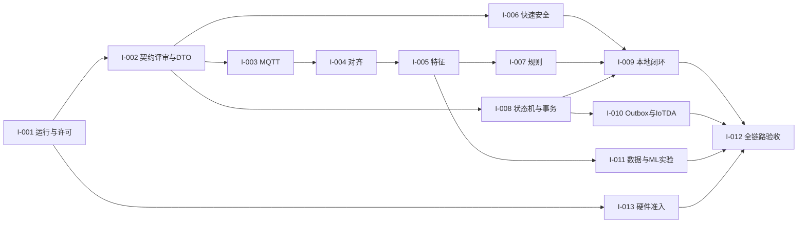

# 水知安开发 Issue 与验收计划

> 2026-10-27 契约技术修订更新：I-002 已产生 V1.2 候选规范、`schema_version=1.1` Schema、DTO、七路由模型及正反测试。A/B/C 会签、业务行为、真实 HTTP/SQLite/MQTT/IoTDA 验收仍待完成。开发放行以 `../contracts/CONTRACT_ACCEPTANCE.md` 的 C0–C5 为准；下列原 I-002 文字是初版规划，不代表本次结果。

> 2026-10-26 进度更新：I-001 的自建本地 API/前端基线与候选上游核查已落地；进程级启动测试 3 项通过，前端 `npm ci`/构建通过。I-002 的待审裁决稿见 [CONTRACT_REVIEW_DRAFT.md](../contracts/CONTRACT_REVIEW_DRAFT.md)。以下 D0 制定的 Issue 内容及“D0 已执行命令”段落保留为当时的规划记录。

以下 Issue 卡片是 D0 的实施提案，依据 V0.5 Spec 第84–123段、V1.1 §1–8、M1–M8 §7–9 和 `tests/BEHAVIOR_TEST_MATRIX.md`。当前 I-002 候选合同与测试已新增，其他业务 Issue 仍须按 `CONTRACT_ACCEPTANCE.md` 验收；编号是仓库内规划编号，并非已创建的 GitHub Issue 编号。

## 执行顺序与依赖

1. P0 I-001 明确复用/自建和运行栈；I-002 先处理 CC01–04 联合契约评审。I-013 硬件准入可同时开展，但不阻塞仿真数据设计。
2. I-002完成后，A开发I-003；B开发I-004→I-005→I-007；C与A完成I-008，C实现I-006。双方用冻结fixtures协作，避免循环等真实模块。
3. I-009连接规则、事件和SQLite，完成 MVP-0 模拟输入→本地三页的可交互闭环，再完成 I-013 的硬件替换和 MVP-1。
4. I-010接入云、I-011采集与算法对照，最后I-012执行Gate与完整实验。无ML收益时保留规则，云缺条件时仅声明Mock与C1。

依赖图（箭头为交付依赖）：

INFERRED：采用里程碑退出条件排期，不预先承诺未经确认的比赛截止日期或三人每日工时。G0/G1/G2/G3 的退出证据见 GAP_ANALYSIS；硬件与云缺席不能自动算通过。

## Issue 卡片

下列代码目录、测试文件、命令全部为未来提案，目前未创建。命令统一在根目录 `.venv` 环境执行；只有文末“D0已执行命令”真实运行。新增测试必须有有效测试收集，不能以不存在的文件、空集合、skip或Mock代替真实集成通过。

### I-001 P0 源码许可与本地运行基线

主责A，B/C评审；无前置。允许README、依赖锁、基础配置和上游核查记录，不改冻结合同。取得Smart Hydro Alert准确URL、commit、LICENSE/NOTICE、前后端/固件清单；如无可确认源则记录采用自建方案及理由。选择Python/FastAPI、MQTT与前端构建版本并锁定，提供最小启动/停止说明。失败用例：缺依赖/端口占用/无配置时给出明确错误。验收提案：`python -m pip check` 与 `python -m pytest tests/smoke/test_startup.py -q`；输出启动日志、依赖锁和许可表。回滚：撤回新增配置和依赖锁，保留原reference。依据Spec I-001/G0。

### I-002 P0 契约联合评审与 DTO

主责 A/B/C，依赖 I-001。已形成 V1.2 候选规范、`schema_version=1.1` 的 9 份 Schema/样例、Pydantic DTO、七路由模型和 S01 联合引用样例；覆盖三类载荷、null、非法枚举、无时区、规则分数与越界数值。当前仅完成 C1/C2 静态技术验证。退出 I-002 仍需三方逐项会签 D1–D5、记录文件哈希与旧 1.0 兼容决议、补齐 S01–S12 行为 fixture，并证明实际入口使用统一 DTO；验收命令和证据按 `CONTRACT_ACCEPTANCE.md`。回滚需同步规范、Schema、样例、DTO 与消费者，不得只回退其中一层。覆盖 CT01/13，依据 V1.2 候选 §6。

### I-003 P0 MQTT 到标准观测

主责A/B评审；依赖I-002。允许`edge/adapters/`、仿真发布器和`tests/adapters/`。输入合包/分包及配置Topic，输出SensorObservation与dead-letter日志。保留received_at/boot/seq/source；复合键去重，不同boot允许重置。失败测试坏JSON、消息重复、掉线和未知设备时间。验收提案：`python -m pytest tests/adapters -q`；MQTT broker 集成另跑 `python -m pytest tests/integration/test_mqtt.py -q`，保存broker/订阅/发布日志与报文。回滚为固定fixture输入。覆盖CT02/13；依据M2 §3–9。

### I-004 P0 事件时间对齐与质量治理

主责B/A评审；依赖I-002，真实接入依赖I-003。允许`edge/alignment/`及`tests/alignment/`。输入观测和注入时钟，输出AlignedWindow；窗口(t-W,t]、W30/S5/L2可配、TTL区分心跳、沉默超时发布、晚到旁路、缓存上限。成功验证t-W排除/t包含；失败覆盖乱序、单路永久沉默、boot变化与无可信时间。验收提案：`python -m pytest tests/alignment -q`；保存输入/窗口/旁路与配置版本。回滚到固定窗口fixture，不伪称实时对齐通过。覆盖CT03/04/13。

### I-005 P0 十二特征与状态恢复

主责B/A+C评审；依赖I-004。允许`edge/features/`及`tests/features/`。输入AlignedWindow与检查点，输出FeatureWindow。逐项黄金数值覆盖时间加权、持续状态、缺失/TTL和断点重启；无证据不续计。验收提案：`python -m pytest tests/features -q`；在线/离线同数据和同到达/截止时钟输出一致，保存golden_features、feature_dictionary和checkpoint。回滚特征版本与消费者模型一起回退。覆盖CT01/16。

### I-006 P0 快速安全信号

主责C/A评审；依赖I-002，联调依赖I-003/I-008。允许`edge/decision/safety*`与`tests/decision/test_safety_signal.py`。输入可信水接触观测，输出SafetySignal进入唯一M6；有效水浸不等待窗口，有人流水不得覆盖湿信号。失败覆盖无效质量、消抖、双路径重复。验收提案：`python -m pytest tests/decision/test_safety_signal.py -q`；保存采集/接收/提醒时间，具体门槛Gate实测后定。回滚为规则演示并标明快速路径未验收。覆盖CT05/06。

### I-007 P0 规则情境与拒判

主责B/C评审；依赖I-005。允许`edge/inference/rules*`与`tests/inference/`。输入FeatureWindow，输出SituationAssessment；C0单阈值/C1即时/C2时序可比较，rules分数null；关键数据缺失或不可区分情形允许UNKNOWN。失败测试把未知当无人或把情境当水浸结论。验收提案：`python -m pytest tests/inference/test_rules.py -q`；保存规则配置、特征版本与解释。回滚至上一规则版本，ML不是本卡完成条件。依据M5 §3–9及ADR-001/002。

### I-008 P0 唯一状态机与 SQLite 原子事务

主责C决策/A存储，B评审；依赖I-002，可先fixture联调。允许`edge/decision/`、`edge/storage/`、迁移及相关测试。输入SafetySignal/Assessment/用户动作，输出Event/Transition/Outbox。每设备每类型每次活动唯一OPEN；版本连续、ACK操作与event组合键稳定、同键不同负载409、旧版本409、确认后湿仍OPEN。失败在三表写入不同位置注入异常并断进程，验证全回滚/恢复；同步worker不能改业务事实。验收提案：`python -m pytest tests/decision tests/storage -q`。保存SQL约束、数据库快照、事务/竞争/重启日志；回滚先备份库并停写，使用迁移回退，不删除业务历史。覆盖CT06–09/14。

### I-009 P0 本地 API 与三页闭环

主责C，A/B审接口；依赖I-008，完整闭环合入I-003–007。允许`edge/api/`、`web/`与API/E2E测试。输入Live/Event/Sync/Trial查询投影，输出三页与受控ACK；实时显示age/quality/source，传感故障和云故障分开，实验受控，simulation不得真实外发。失败覆盖401/404/409/503、重复点击、过期页面。验收提案：`python -m pytest tests/api -q`；前端实施后在web执行`npm ci`、`npm run build`、`npx playwright test`。保存OpenAPI、录屏、导出样本与测试报告。回滚前端版本和只读API，保持事件库。覆盖CT01/07/08/14/15。

### I-010 P1 Outbox Worker 与 IoTDA

主责A/C评审；依赖I-008，SDK路线依据IOTDA_INTEGRATION_PLAN。允许`edge/cloud/`、云映射配置、`tests/cloud/`，不改业务状态。稳定message/transition ID，PENDING→SENDING→ACCEPTED或RETRY_WAIT/FAILED，退避与重启恢复；先Mock后真实设备侧SDK的属性+消息。失败覆盖断WAN、超时、重复回调、密钥缺失和限流。验收提案：`python -m pytest tests/cloud -q`；真实凭据具备时`python -m pytest tests/integration/test_iotda.py -q`，缺配置必须显示未验收。保存SDK SHA/锁/许可与脱敏回执链。回滚禁用worker保留Outbox、本地C1不停止。覆盖CT10/11/15。

### I-011 P1 独立实验数据与轻量 ML

主责B/A+C评审；依赖I-005/I-007，实物实验依赖I-013。允许`experiments/`、`edge/inference/ml*`与`tests/experiments/`。独立Raw/Features/Labels与trial操作真值，先按trial分组，锁定split/配置/特征/模型版本。比较C0–C3的Macro-F1、误报、召回、拒判、时延与样本数量；模型缺失/版本错配回退rules，未校准分数不称事故概率。验收提案：`python -m pytest tests/experiments tests/inference/test_ml_fallback.py -q`；训练/评估CLI在本卡实施时定义并记录，当前没有可运行训练命令。保存split_manifest、metrics和model_card，差结果同样保留。回滚禁用ML。覆盖CT12/16。

### I-012 P1 全链路 Gate 与故障实验

主责全员；依赖I-009/I-010/I-011/I-013。允许`tests/e2e/`、`experiments/reports/`与demo_script。运行S01–S12、E1–E4，按独立C1本地/C2云验收，C3不承诺；报告G0–G3证据和失败项。验收提案：`python -m pytest tests/e2e -q`，配合I-009浏览器与I-010真实云测试，保留CT01–16追踪表；Mock通过不能算硬件/云通过。回滚恢复已验证配置与离线演示。

### I-013 P0 硬件与固件准入

主责A/B评审，依赖I-001，联调依赖I-002/I-003。允许`firmware/`、`experiments/hardware/`及hardware_notes。比较ESPHome/自定义固件对UART、pulse、boot/seq和时间映射支持，记录D0路线选择；在取得板卡型号后固定引脚、供电与电平、工具链、编译命令，不能现在捏造。成功交付三路实物fixture与重复标定，失败覆盖拔线、低流量、静止目标和重启。验收提案：`python -m pytest tests/integration/test_hardware_fixtures.py -q` 加实物日志；仅fixture测试不能替代实物验收。回滚保留simulation来源演示。依据M1 §5–9与Spec第125段。

## D0 已执行命令与完成边界

VERIFIED：`.\.venv\Scripts\python.exe audit/run_audit.py` 已执行，原19项通过，18探针已记录，`pip check`通过，证据见`audit/evidence/`。六份审计文档和README已交付。后续Issue仍未实现；本轮遵守任务“仅审计、不修改业务代码”，没有大规模重构或修改公共契约。

UNVERIFIED: All future business acceptance commands above remain unexecuted.
