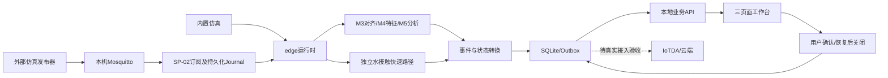

# 非B交付推进：架构、演示与验收

日期：2026-11-11。用户已要求B部分重新验证，B指标和实验结论暂不作为最终签收依据；保留历史证据，不改写为测试失败或删除原始报告。

## 当前执行顺序

1. D2人工验收与界面反馈可继续；B指标正确性单独暂停。实验页可检查布局、分区交互、错误和导出功能，不签收算法结论。
2. D3核对真实IoTDA接入条件、设备身份和回执来源；未经真实接入不得关闭G2。
3. D4先完成不依赖B结果的系统架构、环境复现、状态语义和演示脚本。算法章节保留“待复验”，暂不制作最终效果图或定稿收益结论。
4. A继续实物测试；其结果到位后再安排真实来源适配和同系统联调。现有MQTT运行模式只接受demo01/simulation，不能只改来源字段冒充硬件支持。

## 已核对的系统架构



来源：edge/app.py、edge/runtime.py、spikes/C-business及现有MQTT_WORKBENCH_RUNTIME.md。内置仿真与外部MQTT为可选输入路径，不同时启动两个模拟源驱动同一trial。保留完整仓库及spikes依赖，不能仅复制edge目录作为交付。

## 本地演示准备

在已按现有依赖手册配置的Python环境、仓库根目录执行。普通新克隆仓库应使用其自身虚拟环境；当前多工作树可使用父目录的.venv-app。先执行：

```powershell
npm.cmd ci --prefix web
npm.cmd run build --prefix web
```

选择新的数据库文件和空闲端口，避免覆盖已有证据；下列路径每次演示改用新目录。启动前确认当前终端不继承其他试验配置：

```powershell
$env:AQUAGUARD_RUNTIME='simulation'
$env:AQUAGUARD_DEVICE_ID='demo01'
$env:AQUAGUARD_HOST='127.0.0.1'
$env:AQUAGUARD_PORT='8030'
$env:AQUAGUARD_DB='audit/manual-review-new/business.sqlite'
$env:AQUAGUARD_C_TOKEN=[guid]::NewGuid().ToString('N')
$env:AQUAGUARD_C_CURSOR_KEY=([guid]::NewGuid().ToString('N')+[guid]::NewGuid().ToString('N'))
python -m edge
```

启动后在本机浏览器打开 http://127.0.0.1:8030/c.html，输入上述终端生成的token；仅本机查看，不把token录入视频或证据文件。实验ID为demo-trial。若目录未创建，先用New-Item创建目标目录。不要把baseline默认模式的健康检查成功误认为已启动连续仿真。

MQTT人工演示复用 docs/integration/MQTT_WORKBENCH_RUNTIME.md 的独立进程命令；浏览器自动验收复用 verify_workbench.py --lifecycle 或 --recovery，当前B待复验阶段不传 --evaluation-report。新输出目录、空闲端口、自有进程退出和证据归档要求不变。

## 初版录制脚本（不依赖B指标）

| 顺序 | 操作 | 应展示的事实 | 证据 |
|---|---|---|---|
| 1 | 展示版本与输入模式 | 本机仿真或真实输入来源明确 | commit、配置摘要（去除凭据） |
| 2 | 打开总览并等待更新 | 三源数据与质量/时间更新 | 页面录屏 |
| 3 | 观察水接触事件 | 感知到事件进入同一工作台 | 事件ID与时间线 |
| 4 | 点击我已知晓 | 用户确认记录，物理状态不被按钮清除 | ACK状态及导出记录 |
| 5 | 输入恢复后关闭 | 只有恢复且已确认才可关闭 | 生命周期、版本及关闭记录 |
| 6 | 再次触发 | 新未确认事件，旧记录保留 | 两个事件ID |
| 7 | 展示同步状态 | 本地待同步如实展示；真实云未接通就明确说明 | Outbox状态；云回执若实际存在另附 |
| 8 | 停止输入或使用独立恢复场景 | 过期后隐藏旧值，恢复后重新显示 | 恢复场景结果及录屏 |

内置仿真不保证恰好按此录制时间表恢复；完整恢复/复发流程使用已支持该输入时间线的MQTT lifecycle场景。录屏不剪辑伪造云成功或硬件来源。B章节当前只介绍分析模块位置和“结果待复验”，不展示最终收益判断。

## 云端与硬件补证清单

| 工作 | 责任建议 | 依赖 | 可接受证据 |
|---|---|---|---|
| 确认IoTDA产品/设备/区域/接入协议 | C及账号持有人 | 已有云账号权限 | 去敏配置与设备身份对应关系 |
| 真实云接收与本地事件关联 | C | 实际运行云连接器 | 本地事件/消息身份、云接收时间与回执来源 |
| 实际断网后补传 | C | 已通过真实接收 | 断网期间pending、恢复后云接收及幂等关联 |
| 硬件DTO与来源适配 | A+C | A原始观测、单位/时间/boot/质量定义 | 真实输入样本、适配测试、同系统运行证据 |
| CodeArts工程证据（按既定交付要求） | C | 项目权限与实际流水线 | 实际构建记录及对应提交，不能用本地pytest替代 |

不在缺少云接入参数时新建云资源，不把进程隔离原型写成已发布连接器。真实账号/设备参数缺失时，先由C整理现有接入信息，再安排联调。

## 阶段状态

- D1：装置和视频仍待完成；本脚本是准备材料，不是已录制视频。
- D2/G1：已有本地自动验收证据，用户人工验收继续。
- D3/G2：真实云端和硬件仍未验收；本轮只完成接入前核查与证据要求。
- D4/G3-G4：非B架构与演示材料继续；B正确性和最终结论等待重新验证。

本文件命令按源码与现有手册交叉核对，尚未执行一次新的人工演示或新环境部署，不能据此标记复现验收通过。
