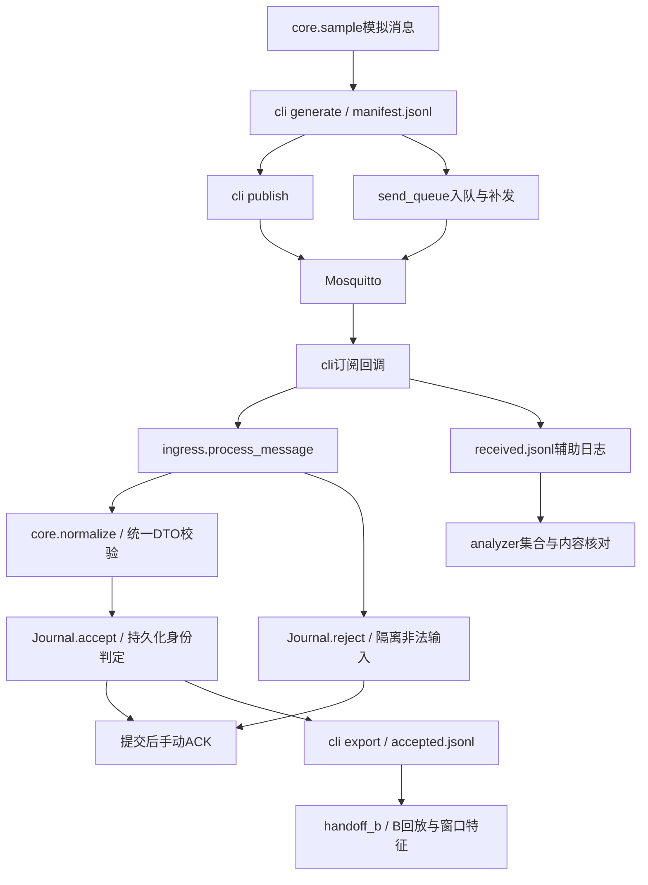

# A 代码地图与算法导读：从0开始

核对日期2026-11-03。按当前工作区代码说明，不代表本轮重新运行测试。A实现主要在spikes/SP-02，是电脑端技术验证原型；不是已经完成的ESP32采集固件。

## 0. 先理解四个基础概念

JSON是一条结构化消息；JSONL文件每行一条JSON，适合保存事件。MQTT负责发布/订阅，Mosquitto是转发消息的Broker。DTO是数据结构与语义约束。SQLite是本地持久化数据库，进程退出后已提交记录仍可再次读取。

一条测量与一次发送不相同：一条测量可以重发多次。A的目标是保存每次尝试，但同一测量只作为一个有效输入交给B。

## 1. 先看完整调用链



数据输入有两条可选路线：普通publish或持久队列flush，前者不自动经过后者。export只导出首次接受/乱序接受，异常与重复保留在审计中。

## 2. 第一步：认识数据合同

读`edge/contracts/models.py`的SensorObservation、三个Value模型和validate_raw_observation。

SensorObservation包含device_id、sensor_type、boot_id、seq、uptime_ms、event_time、received_at、time_basis、value、quality、source等。flow/water/presence的value结构不同；未知是null，不是false。原始入口只接受valid/invalid/unknown，不能把后处理duplicate写回原始质量字段。

模型负责类型、范围、时间格式和交叉字段约束，不负责跨消息去重、证明时钟同步或发现传感器断线。该文件为共享候选合同实现，不是A独自定义的传感器算法。

## 3. 第二步：读core.py，理解核心处理

路径：`spikes/SP-02/src/core.py`，建议按以下函数阅读。

### 3.1 sample：生成模拟观测

按sensor选择固定value，填模拟身份/序号/uptime及source=simulation，再生成observation_id。流量值和calibration_id是演示数据，不是实际标定；uptime由seq计算，不是读取设备时钟。不能拿它证明物理精度。

### 3.2 identity、observation_id：稳定消息身份

身份组合为[device_id,sensor_type,boot_id,seq]，将紧凑JSON的UTF-8字节做SHA256得到ID。相同组合得到相同ID，重发不生成新测量；不同传感器或boot可使用相同seq。

SHA256在此用于确定性标识，不是加密、设备签名或授权。同一身份内容被改动仍会得到相同ID，所以后续还要比较内容。boot_id由输入提供，本代码不为真实设备生成启动标识。

### 3.3 normalize：设备载荷变为完整DTO

依次解析JSON对象、拒绝设备自行提供received_at、核对配置中的device/source、限制为RECEIVED_FALLBACK且event_time=null、核对ID，再补边缘UTC接收时间并调用共享校验。

这里的时间策略是明确承认没有可信设备时钟，不是“自动校时算法”。接收时间有回调排队误差，不能当原始测量时间。

### 3.4 Journal：持久化分类

|表|作用|
|---|---|
|observations|唯一身份及稳定内容，id主键和组合键唯一|
|attempts|每次合法处理的分类与完整DTO，包括重复/冲突|
|rejected|非法报文、错误原因与原始字节等隔离记录|

accept先去掉received_at并稳定序列化内容，然后按组合键或ID查询：

```text
已有身份且内容相同 → duplicate
已有身份但内容不同 → conflict
没有身份、同device/sensor/boot存在更大seq → out_of_order，仍接受
否则 → new，接受
```

received_at不参加重复内容比较，因为同一消息重发会有新接收时间。new/out_of_order插入唯一表；所有合法尝试写attempts，处于同一SQLite事务中。export只返回new/out_of_order。

乱序只表示序号小于已见序号，不等于窗口迟到，也不推断不同boot谁更新。当前乱序检查扫描并解析已有记录，新增N条时累计成本可能达到O(N²)，仅适合受控小规模原型，非高吞吐实现。

## 4. 第三步：读ingress.py，理解何时确认

`process_message`依次检查Topic/retain、normalize，再调用accept；非法输入调用reject。提交成功后执行after_commit钩子，再调用acknowledge。

存储异常不被当作坏JSON吞掉，会向外抛出，因而不确认。CLI捕获后记录错误并断开。非法输入只有隔离记录成功保存后才确认，避免反复重投坏包。after_commit用于注入“数据库提交后、确认前崩溃”。

该策略允许重投，用去重保护唯一输入，不是网络exactly-once。跨进程重投要求稳定客户端ID、持久会话及Broker保留相应状态；当前无Broker持久化保证。

## 5. 第四步：读cli.py，把模块串起来

这是普通实验入口，不需要先读Web或FastAPI。

|子命令|做什么|输出|
|---|---|---|
|generate|轮流生成flow/water/presence|manifest.jsonl|
|publish|逐行发MQTT QoS1，等待传输确认|连接日志；--interval控制发送间隔|
|subscribe|订阅→process_message→SQLite→手动确认|SQLite、received.jsonl、连接时间线|
|export|读Journal.export|accepted.jsonl|

先看main参数，再看connected/subscribed/disconnected，最后message。连接成功后订阅，收到订阅确认才READY；断开后Paho按1–4秒配置退避并恢复订阅。A调用库的重连实现，没有自写MQTT协议栈。

`--persistent-session`保留会话；`--crash-after-commit`直接退出73，仅用于实验。默认设备、Topic、来源固定为prototype01/simulation，不可直接接真实设备。

received.jsonl在数据库提交和ACK调用之后写，崩溃可能导致数据库有记录而JSONL没有记录。因此数据库/唯一导出是处理事实，不能把JSONL当原子事务的一部分。

## 6. 第五步：读send_queue.py，理解电脑端补发

SendQueue保存id、规范化payload、confirmed。enqueue同身份同内容忽略，异内容报错；flush按入队顺序处理confirmed=0，send成功返回后才提交confirmed=1。连接失败或send抛错则保留待发状态，新进程可重试。

CLI发送用QoS1等待Broker确认。确认后本地标记前崩溃可能再发，依靠订阅端去重。confirmed不等于订阅端或业务完成；订阅者不在线且Broker不缓存时仍可能没有下游接收。

队列是电脑SQLite实验，无容量限制、不是ESP32缓存，也不是C部分事件Outbox；二者业务意义不同。入队不替代完整载荷校验。

## 7. 第六步：读analyzer.py，理解验收统计

输入manifest（预期）及received记录（实际），执行集合与内容核对：缺失=expected−actual，额外=actual−expected；接受条数应与唯一数一致。忽略边缘received_at后比较内容，检查manifest同ID异内容，拒绝未知分类。空实验不能PASS，invalid/conflict使正常基线FAIL。

这是受控实验核对，不是传感器准确率或网络单向延迟计算。依赖辅助JSONL，不能直接用于确认前崩溃场景，那类场景需查询SQLite事实。故障实验预期有冲突时，由场景脚本检查预定分类，不拿普通基线PASS条件硬套。

## 8. 第七步：读handoff_b.py，理解A/B边界

先调用B replay验证、拒绝重复ID并按接收时间排序；再按(device_id,boot_id)分成独立实验，取该组最后received_at作为窗尾，调用B align和compute。窗口30秒、允许迟到2秒、TTL10秒和流量阈值0.1仅为原型配置，不是硬件测定值。

experiment_id由device/boot计算，跨实验使用(experiment_id,window_id)引用。窗口或特征计算ValueError保存BLOCKED原因；整体PASS/PARTIAL，CLI输入格式/语义失败写FAIL并非零退出。窗口错误时window=null，特征不能算时features=null。

本文件负责编排和隔离，不自行实现窗口、TTL、十二特征或漏水分类。

当前B目录已变更：`spikes/SP-03/src`负责回放/对齐，`spikes/SP-03-features/src`负责特征，`spikes/SP-04`负责推断。旧报告中的M4/M5是历史目录名称，当前阅读以实际路径为准。

## 9. 第八步：读验证脚本与测试

|文件|验证内容|
|---|---|
|verify_mqtt.py|真实本机Broker，重复/乱序、冲突/非法、进程重启、Broker重启和持续订阅器重连|
|verify_crash.py|提交后ACK前退出73，持久会话重投后new/duplicate且唯一1|
|verify_release.py|串行运行单元/契约/启动、MQTT、崩溃三个门槛，保存日志和summary|
|test_core.py|三源格式、非法输入、未知、身份分类和跨数据库重开|
|test_ingress.py|提交后确认、存储失败不确认、非法字节/JSON/retain隔离|
|test_send_queue.py|发送失败保留、重开补发、入队身份冲突|
|test_analyzer.py|缺失/额外、空实验、内容冲突及未知分类|
|test_handoff_b.py|来源/时间保留、多设备/boot隔离、重叠流量及重复拒绝|

验证脚本会启动本机进程或强制退出实验客户端，先读README使用新目录和空闲端口；不是普通业务功能。

## 10. A到底实现了哪些算法

|算法/机制|位置|解决的问题|
|---|---|---|
|组合身份+确定性SHA256|core.identity/observation_id|重发与新测量身份一致性|
|内容规范化比较、持久去重与冲突检测|Journal.accept|同一测量只接受一次，同身份篡改不覆盖|
|按源/boot的序号乱序检测|Journal.accept|发现迟到序号；不作时间窗口判定|
|接收时间回退与严格标准化|normalize+共享DTO|无可信时钟时明确退化，拒绝不合法数据|
|事务提交后确认与持久隔离|ingress+Journal|避免存储未成功却确认，错误包可追溯|
|持久待发状态及确认后更新|SendQueue|电脑进程间保留发送任务，可恢复重试|
|集合差与内容完整性校验|analyzer|避免“数量一样但消息错了”仍PASS|
|按device/boot分组与实验命名空间|handoff_b|保守隔离无法证明连续的启动周期|
|重连退避与重新订阅|cli调用Paho|恢复传输连接，非自研网络算法|

这些主要是数据完整性和可靠性算法。尚未实现A实物脉冲采集/标定、消抖、雷达UART解析、时钟同步/映射或ESP32持久缓存。文档里的标定公式属于待执行设计，不能当作已存在驱动。滑窗、TTL、特征、规则/ML属于B，事件状态机/业务事务属于C。

## 11. 与正式服务的区别及建议学习顺序

`edge/config.py`读取本地服务配置，`edge/app.py`建立健康检查，`edge/__main__.py`启动Uvicorn；运行python -m edge不会自动启动SP-02链路。`api_models.py`是API模型而非全部已实现路由。

建议：先用纸写一条water消息→算identity→看normalize→逐次跟踪new/duplicate/conflict→读ingress确认顺序→理解CLI收发→模拟失败补发→看analyzer→最后对接B和读故障脚本。遇到每个算法先看对应test，再看真实evidence，不必先通读所有日志。

本轮仅核对并编写代码地图，未重新测试或改写代码；工作区其他成员的改动保持原样。
