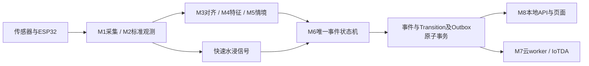

# A 部分项目地图与技术验证后的路线

补充阅读：[代码地图与算法导读](A_代码地图与算法导读.md)解释当前实现；[零基础实验手册](A_零基础实验与数据采集手册.md)细化采集与处理。当前B目录为spikes/SP-03-features和spikes/SP-04，历史M4/M5名称仅供理解职责。

更新：2026-11-02。范围是A采集/通信及其与B算法、C事件/云的接口。软件实验已执行，硬件已购入但实物实验尚待执行；技术验证尚未全部结束。本文不是放行或会签记录。

## 1. 先理解项目处于哪一层

这张图是目标业务链路，不表示上述模块全部正式实现。spikes/用于独立原型，edge/用于正式服务；现有edge/app.py主要是健康检查。原型测试通过不代表业务服务已经完成。

## 2. 按这个顺序阅读

1. 根README.md、本文：理解目标、边界、原型与正式实现的区别。
2. A_任务单.md、A_软件阶段收尾报告.md：先知道责任和当前做到哪里。
3. A_实物实验设计与执行方案.md、A_软硬件结合开发手册.md：当前最应执行的实物阶段。
4. 候选合同D1/D2、SP-02/WIRE_PROTOCOL.md、TIME_ASSUMPTIONS.md：弄懂数据与时间，尤其未知、身份、补发限制。
5. SP-02/README.md及src/代码：实际跑通软件，观察日志和SQLite事务边界。
6. AB_交叉自检报告.md、AB_第二轮交叉核对.md、B的DECISION_TABLE.md：理解为什么某些合法消息仍不能直接计算特征。
7. contracts/STATUS.md、CONTRACT_ACCEPTANCE.md和候选合同全篇：准备正式评审与放行。
8. project/DEVELOPMENT_PLAN.md：将实验证据转换成正式开发Issue和验收。该文档包含历史提案，目录/命令必须按实际仓库确认后使用。

只做当前实物执行时，先读第1–4步；负责正式软件时继续读第5–8步。不必按文档创建时间从头读所有历史报告。

## 3. A部分文档逐份索引

以下路径相对docs/spikes/；链接均指向仓库文件。

|文档|包含内容|什么时候读|
|---|---|---|
|[A任务单](A_任务单.md)|SP-01/SP-02责任、交付、最低实验要求|首次了解分工|
|[双线计划](A_双线开发计划.md)|采购和软件并行路线、阶段门槛、初版物品清单|理解整体计划；采购以确认单补充为准|
|[采购确认](A_采购确认.md)|可先买/待确认物品、型号、信号适配与卖家问题|已购后用于核对到货，非接线图|
|[软件实施计划](A_软件开发实施计划.md)|模块接口、身份/时间、存储、固件工作包与测试矩阵|理解软件设计；部分任务已落地|
|[软件验证进度](A_软件验证进度.md)|阶段增量、已测能力和当时待办|追踪过程；最新完成范围看收尾及交叉报告|
|[软件收尾报告](A_软件阶段收尾报告.md)|软件范围、证据、复现、B交接、未完成可靠性门槛|评审软件阶段的主入口|
|[软硬件开发手册](A_软硬件结合开发手册.md)|环境、Broker和CLI部署、到货核验、联调与排障步骤|上手操作；硬件参数未确定|
|[实物实验方案](A_实物实验设计与执行方案.md)|分阶段实物实验、次数、真值/指标、工作包及时间对接|当前执行主文档，尚非已完成实验报告|
|[A/B第一轮自检](AB_交叉自检报告.md)|分支核对、flow区间重叠、boot隔离及真实交接|理解跨模块限制|
|[A/B第二轮自检](AB_第二轮交叉核对.md)|内容一致性、manifest冲突、结构化失败与206项回归|复核修复及现有边界|
|[分批提交说明](A_分批提交说明.md)|三批提交范围、哈希、验证和限制|定位远端改动、安排Review|
|[B任务单](B_任务单.md)|SP-03/04责任和交付|与B讨论数据接口|
|[SP-06计划](SP-06_编码计划.md)|C的SQLite/Outbox原型计划|理解与正式事件存储的关系|
|[跟踪表](SPIKE_TRACKER.csv)|六项Spike状态、负责人和证据路径|管理进度；不是验收替代品|
|[组长分发话术](组长分发话术.md)|成员任务说明及协作提醒|分派工作|
|[团队手册](Technical_Spike_团队分工手册.docx)|早期六项Spike组织方式|背景材料；最新职责以任务单/跟踪表为准|
|[Issue模板](templates/SPIKE_ISSUE_TEMPLATE.md)|目标、范围、依赖和验收卡片|新建实验任务|
|[报告模板](templates/SPIKE_REPORT_TEMPLATE.md)|环境、命令、输入/期望/实际、限制和交接|每轮真实执行后填写|

## 4. 代码、协议与证据地图

路径相对仓库根目录。

|位置|内容|推荐阅读顺序|
|---|---|---|
|spikes/SP-02/README.md|软件复现命令、工具使用与限制|1|
|spikes/SP-02/WIRE_PROTOCOL.md|实验线上格式、Topic、身份算法|2|
|spikes/SP-02/TIME_ASSUMPTIONS.md|事件/接收时间、boot/seq、补发不等于历史测量|3|
|spikes/SP-02/src/core.py|标准化、身份、SQLite接受/隔离与导出|4|
|spikes/SP-02/src/ingress.py|持久化成功后确认，错误分类边界|5|
|spikes/SP-02/src/cli.py|模拟生成、发布、订阅、导出、连接日志|6|
|spikes/SP-02/src/send_queue.py|电脑发送端持久队列及传输确认|7|
|spikes/SP-02/src/analyzer.py|身份集合及内容核对、统计失败条件|8|
|spikes/SP-02/src/handoff_b.py|按device/boot独立实验进入B对齐和M4|9|
|spikes/SP-02/src/verify_mqtt.py|重复/非法/重启/自动重连场景编排|10|
|spikes/SP-02/src/verify_crash.py|提交后ACK前进程崩溃、重投与去重|11|
|spikes/SP-02/src/verify_release.py|统一软件门槛命令|12|
|spikes/SP-02/tests/unit/|上述行为正反例，含真实SQLite只读错误|跟随相应代码读|
|spikes/SP-02/config/|仅回环实验Broker配置|部署前读，不用于硬件LAN直连|
|spikes/SP-02/REPORT.md|历史增量报告|查演进，不覆盖最新收尾结论|
|spikes/SP-02/evidence/|发送/接收、连接日志、失败与成功summary、交接JSON|用收尾报告索引选择，不把所有文件都当成功证据|

运行SQLite库被忽略，不在远端；需按脚本复现。历史100条突发日志仅证明通信；ab-paced数据才用于已有真实MQTT→B特征交接。原始received日志不能直接替代唯一accepted DTO。

## 5. 相关规格和跨团队入口

|位置|包含内容及阅读目的|
|---|---|
|docs/README.md|全仓文档导航|
|docs/contracts/STATUS.md|候选合同现状、会签与Spike使用方式|
|reference/reference_02/00_Contracts_V1.2_修订候选.md|D1三源、D2窗口特征、D3来源事件、D4 API/Outbox、D5验收；非已会签正式合同|
|reference/reference_02/contracts/|机器Schema、对象样例及S01联合样例|
|edge/contracts/models.py、api_models.py|实际Python DTO语义及API模型；不是已运行完整业务接口|
|docs/contracts/CONTRACT_ACCEPTANCE.md|契约分层门槛、证据与放行|
|docs/contracts/CONTRACT_JOINT_REVIEW_REPORT.md|联合评审发现和D1–D5议题|
|docs/contracts/CONTRACT_REVIEW_DRAFT.md、CONTRACT_COMPLIANCE.md|历史评审建议和旧版本缺陷背景，不当当前完成状态|
|reference/reference_02/modules/M1_感知采集.md、M2_消息通信与标准化.md|A正式模块职责及边界；字段以候选修订优先|
|同目录M3/M4/M5文档|B对齐、特征、推断目标及失败退化|
|同目录M6/M7/M8文档|事件、云协同、页面目标|
|spikes/SP-03/DECISION_TABLE.md、README.md及REPORT_R01–R06.md|B待确认语义、回放/窗口实现与历史证据|
|spikes/SP-03-features/README.md及REPORT_R01–R06.md|特征原型、连续状态与实现限制|
|spikes/SP-04/README.md、spikes/SP-06/README.md|B规则与C事务原型入口，以实际文件和报告确认状态|
|docs/integration/IOTDA_INTEGRATION_PLAN.md、IoTDA_人工对接操作指南.md|云映射、真实接入前置条件、人工配置与回执门槛|
|docs/project/DEVELOPMENT_PLAN.md|I-001–I-013依赖、正式模块职责和验收提案，含历史状态|
|docs/audit/REPO_AUDIT.md、GAP_ANALYSIS.md、DEPENDENCY_RISKS.md|早期资产、差距及依赖风险背景|

## 6. 技术验证结束后，不是直接复制原型上线

### 阶段一：收敛实验结论并评审

先完成实物实验和Reviewer复核；每项结论绑定设备、固件、配置、原始证据与限制。把未知字段/boot策略/时间映射/flow区间/失联诊断形成决议包。独立审查未通过、参数没有证据时保留PARTIAL/BLOCKED。

产物：实物REPORT、校准与hardware fixtures、参数清单、已知问题、A/B交接样例、Reviewer结论。不必等待所有探索题成功，但缩小承诺必须明确并经评审。

### 阶段二：冻结接口并拆正式Issue

A/B/C按D1–D5逐项会签，记录版本/哈希、历史兼容、来源授权及行为fixture。按CONTRACT_ACCEPTANCE门槛批准进入正式实现，不把206项原型/回归测试当三方签字。

以DEVELOPMENT_PLAN为依赖骨架更新Issue：每卡写输入/输出、允许修改目录、依赖、负责人/Reviewer、行为断言、复现和回滚。旧计划中云的A主责与最新SP-05由C负责须组内明确正式模块归属，不能机械沿用旧表。

### 阶段三：把实验能力工程化

A落实I-003接入和I-013硬件准入；B推进I-004/005/007；C推进快速安全、唯一事件、事务与页面。复用经验证算法和fixture，但正式目录/服务生命周期/配置/日志/错误语义重新设计并评审。

A重点补：身份与设备授权、硬件/模拟来源隔离、参数和标定版本、串口/网络健康、时间映射失效、容量限制、背压、持久化与恢复策略、密钥管理和LAN部署。正式入口真正调用统一DTO；测试失败与存储失败不能误判为普通坏报文。

### 阶段四：先完成本地纵向闭环

先用受控fixture接通观测→窗口/快速路径→情境/安全信号→唯一事件→SQLite/Outbox→API/页面，再替换真实传感器。验收有效水浸不等待慢窗口、确认不等于物理恢复、未知不等于干燥/无人、两条路径不产生重复活动事件。

同时测并发ACK、幂等重放、版本冲突、进程重启与断WAN本地可用。页面显示数据来源/质量/更新时间及云同步状态，不能将这些合成一个“正常”灯。

### 阶段五：云与算法分别验收

本地闭环稳定后推进真实IoTDA、Outbox重试和可关联回执。连接成功或MQTT确认不代表联系人收到。C1本地、C2云、C3联系人分别命名，C3不是默认承诺。

算法先保留可解释规则，开展独立trial真值、按trial分组切分与规则/ML对比；ML无增益可保留规则。设备硬件正常不意味着分类准确；新采样/特征版本会影响模型，必须联动验证。

### 阶段六：正式验收与交付

按行为矩阵运行全链路场景与故障；记录真实硬件、真实云、模拟和未完成项。交付版本、依赖锁、迁移、配置模板、部署/停机/恢复流程、演示脚本和证据索引。先部署隔离演示环境再按验收范围交付，不扩大为真实家庭安全保证。

## 7. 当前下一步清单

1. 补实物型号/手册、供电与接线复核，确定板型和工具链。
2. 按实物方案逐源实验，建立真实数据与操作真值。
3. 优先解决flow测量区间和时钟映射，再做B真实连续输入；离线补发不能当实时状态。
4. 实物与软件证据交Reviewer，再组织合同会签与正式Issue分工。

本文仅新增路线与索引，未宣称实验已完成或批准正式迁移。后续随真实评审和实测更新。
