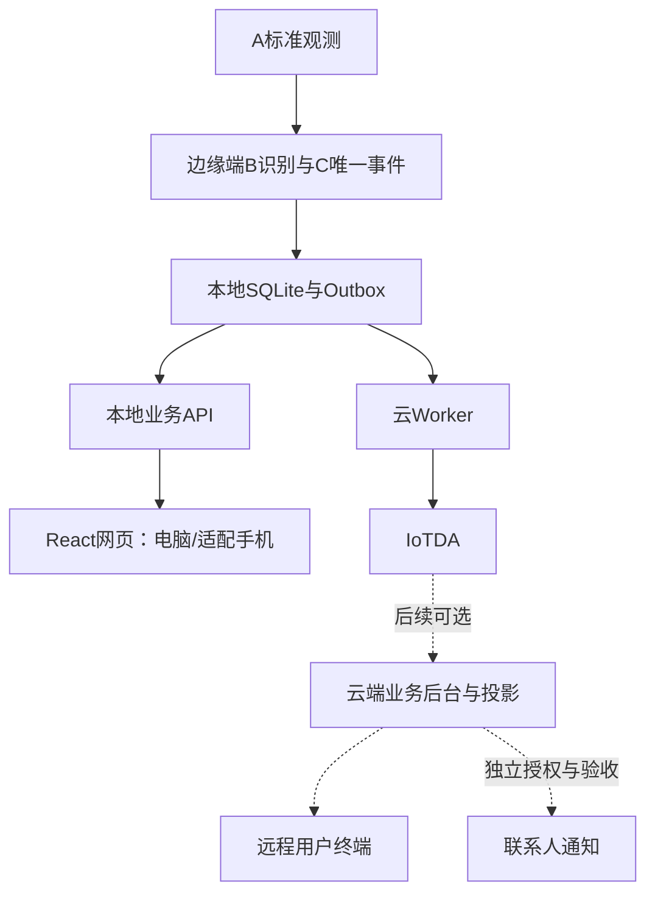

# C部分业务、终端与云协同路线

最新落点（2026-11-03）：R05本地Mock worker批次收尾，相关回归128项通过；见[R05报告](C_R05_STAGE_REVIEW.md)。真实IoTDA/生产可靠性/独立验收未完成，R04浏览器缺口仍保留。下文较早阶段记录用于追溯。

更新：2026-11-03。本文件统一说明C部分交付范围与后续依赖；实际开发证据见[C阶段记录](C-business/README.md)，全局状态见[统一进度表](../../../docs/project/PROJECT_STATUS.md)。规划不是验收，候选契约未会签，不据此宣布正式放行或创建云资源。

当前落点：R04a已编写本地三页、双入口构建与页面HTTP交付，增加B实际历史工件引用校验与独立导入。相关回归112项通过，随后runtime专项5项通过；见[演示入口](C-business/LOCAL_DEMO.md)。浏览器工具启动失败，点击/视觉/E2E尚未完成，R04仍PARTIAL；持续B输出及真实IoTDA待接入。七路由数量不是全系统完成比例。

R04b最新收尾：新增真实B检查点gate/classify桥接、实时/情境原子发布及前端重试/响应顺序保护，回归115项与Node状态3项通过。见[阶段收尾报告](C_R04_STAGE_REVIEW.md)。桥接逐窗口内部调用，不代表自动在线调度完成；系统盘0，浏览器验收依然未完成。后续可先推进R05，同时保留R04验收缺口。

## 1. C负责什么

|层次|职责|当前实现位置/边界|
|---|---|---|
|M6决策|快速水接触、安全与情境分离、唯一事件、确认与物理恢复分离|spikes/C-business/policy.py、water.py；水接触分支原型，完整风险升级与关闭/复发待决议|
|M7存储|事件权威库、连续历史、事务Outbox与幂等操作|store.py；受控SQLite原型|
|M7同步|持久消息、重试调度、回执、IoTDA适配|SP-06为Mock技术验证；业务Outbox已有待发记录，真实adapter未接入|
|M8产品|本地API、实时总览、事件确认、实验诊断|api.py及projections.py为隔离原型；正式web仍仅连接检查|

SP-05/06由C（项目统筹负责人）承担；旧M7规格/开发计划含A主责记录，正式存储与云模块Owner及A协作范围仍待组内明确。不得将旧分工与最新分工混作已确认责任。

## 2. IoTDA与用户终端的边界

IoTDA提供设备接入、管理、应用侧API及数据转发能力；它的管理控制台用于开发、调试和设备管理。本项目的用户页面、事件ACK规则、业务历史和权限仍由应用层实现。

官方依据：[开发前必读](https://support.huaweicloud.com/devg-iothub/iot_02_9994.html)、[功能概述](https://support.huaweicloud.com/usermanual-iothub/iot_01_0015.html)、[应用侧API](https://support.huaweicloud.com/intl/zh-cn/devg-iothub/iot_02_9981.html)、[数据转发方式](https://support.huaweicloud.com/usermanual-iothub/iot_01_00140.html)。2026-11-02查阅；具体区域、实例与SDK能力仍需真实接入核实。

图中虚线为后续方案，不代表当前承诺。真实云接入完成不等于远程页面或联系人送达已完成。

## 3. 用户如何使用

优先交付本地React网页，先电脑浏览器，再适配手机屏幕；本阶段无需另建原生App或小程序。手机同Wi-Fi访问还依赖局域网监听、网络与访问权限配置；当前正式服务仅本机监听，不能声称手机已能访问。

|页面|必须呈现|交互边界|
|---|---|---|
|实时总览|三源状态、质量、age/captured_at、用水情境、独立安全信号、云状态、来源|断云不能显示为传感故障；陈旧数据不能显示为当前正常|
|事件确认|生命周期、确认状态、物理状态、风险级、版本与转换历史|ACK只表示知晓；仍湿时保持相应异常，409后重新取数|
|实验诊断|trial与来源、状态、证据引用、回放/导出结果|实验操作受控；不得触发真实联系人；查询引用不等于任意文件下载|

例：同一事件可以同时是OPEN、ACKNOWLEDGED、ACTIVE，云同步为PENDING。页面分别表达“已确认、仍湿、待同步”，不合并为“已处理”。

## 4. 依赖顺序与退出条件

|阶段|工作|退出条件|不代表什么|
|---|---|---|---|
|C-R01|纯水接触策略|未知/TTL/干燥证据/ACK边界有反例|不代表持久化或真实参数最优|
|C-R02a/b|事件事务、可信输入与证据状态|唯一OPEN、幂等、并发、重启、回滚与超时限定范围可复现|不代表完整M6或断电可靠性|
|C-R03a|事件列表/详情/ACK API|候选模型、权限、分页、错误与事务行为可验证|不代表浏览器或正式部署|
|C-R03b|实时/情境/同步/实验查询|可信后端发布投影；缺失404、过期503；同步来自Outbox事实|七路由存在不代表已有真实数据源|
|C-R03c|本地启动与演示装配|独立配置、受控输入、timer调度、启动/停机和网络实测|不得绕过契约放行直接合入正式服务|
|C-R04|本地三页、A/B工件交接|观测→事件→页面→ACK→持久化；来源/质量/时间可见|不以fixture冒充实物|
|C-R05|业务Outbox运行与Mock适配|持久退避、稳定ID、恢复、迟到/重复结果处理、停止与故障可见|不等于真实IoTDA|
|SP-05及云联合阶段|固定SDK与真实IoTDA|属性/消息/回执关联，断WAN本地继续、恢复补传|不等于联系人收到|
|C-R06|独立评审、正式迁移与联合验收|契约会签、Reviewer、CT映射、版本/回滚/部署证据|未通过项不得从报告删除|

无硬件/云仍可推进R03–R05。完整实物与云验收另按条件开展，不把未执行项记PASS。

## 5. 远程应用是否属于当前范围

本地三页属于既有M8规划；真实IoTDA属于既有SP-05/M7规划。完整远程用户后台、跨互联网ACK和联系人通知作为后续范围管理，不能因接入云自动视为已批准实施。

若确认需要远程产品，还需单独拆任务：

1. IoTDA消息订阅/转发到云端接收服务，校验身份、稳定ID与版本，持久化查询投影。
2. 用户与设备权限、远程API和可过期状态；前端不持有设备密钥或云端管理凭据。
3. 远程ACK沿受控链路返回边缘M6，执行expected_version与idempotency_key；未获边缘确认时显示待处理，不能直接改写云副本当成功。
4. 处理双向离线、重复、顺序冲突和最终一致性；本地事件事实仍由边缘M6/SQLite权威维护。
5. 若加入联系人或第二投递目的地，先评审合同/Outbox唯一键迁移、独立重试和回执，再实现通知。

远程部署的具体服务、区域、成本与身份方案未选定，本文件不创建资源或预设套餐。

## 6. 接口与验收规则

- A→C：正式观测DTO、可信device/source、boot/seq、时间映射与补发标记策略；fallback不能重建补发测量时间。
- B→C：情境与安全信号分开，核验device/window、origin、版本与时效；不拿新发布时刻刷新旧窗口证据。
- C→前端：只读查询和受控ACK；不开放原始观测/投影写HTTP接口，不允许浏览器直写SQLite。
- C→云：worker只改投递事实，不能改事件物理/确认状态；传输回执与业务回执分层。
- 当前投影写入为受信后端接口；DTO校验不等于引用真实性，真实接入仍需证据链核验。
- C1本地、C2真实IoTDA、C3联系人分别验收；这里的C1–C3为交付层次，不等同契约门槛C0–C5。
- 未会签合同维持候选；Reviewer待指定。测试总数含重叠历史范围，不能相加计算完成率。

## 7. 待决议清单

|议题|当前处理|应由谁确认|
|---|---|---|
|关闭/复发/风险升级|不自动关闭，不默认新增风险策略|C牵头，A/B复核|
|origin变化与历史一致性|明确拒绝合并，不回写历史|A/B/C契约评审|
|设备可信时间及补发准入|暂仅fallback，需输入链限制补发清除|A牵头，B/C复核|
|正式M7与部署职责|SP由C负责，正式协作待明确|项目统筹与A|
|远程产品与通知范围|后续方案，未当作当前MVP完成条件|项目统筹确认|

维护方式：状态更新到统一进度表，实跑与限制更新到C阶段记录；产品范围或依赖变化更新本文件。不得仅修改一处并将旧报告视为最新状态。
